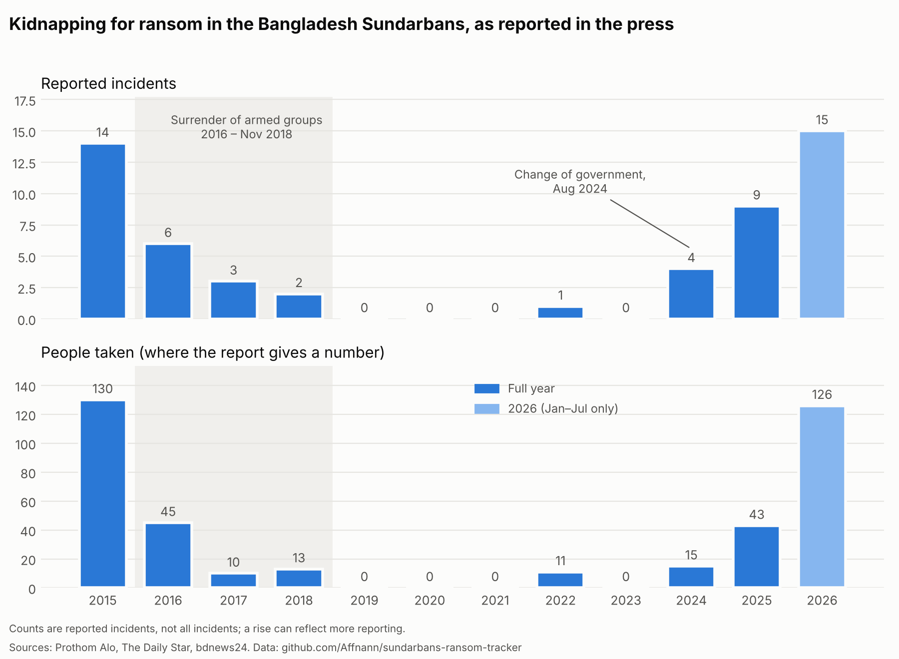
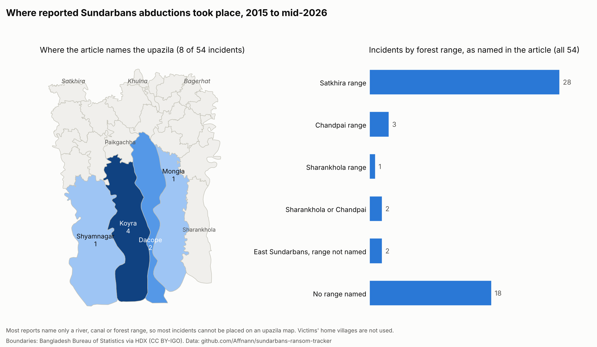

# Sundarbans Ransom Tracker

[](https://doi.org/10.5281/zenodo.23766432)

Published by [Mercenomics](https://mercenomics.org), an independent data archive on the business of force for hire.

A hand-coded record of kidnapping-for-ransom incidents in the Bangladesh Sundarbans, built from published news reports, February 2015 to October 2026.

Fishers, crab collectors, honey gatherers and woodcutters who work in the Sundarbans forest have long been abducted by armed groups and held until their families pay. No official dataset of these incidents exists. This project builds one from news coverage, mostly in Bangla, so that the size, prices and timing of the ransom trade can be measured, including before and after the 2016–2018 surrender campaign.

**Version 1.0.1** (29 October 2026; same data as 1.0.0): 63 incidents involving 439 people where a number is reported, from Prothom Alo, Kaler Kantho, Samakal, The Daily Star and bdnews24, plus 9 records of protection payments.

## Key findings
- **2015:** 14 reported incidents and 130 people taken.
- **2019–2023:** one reported incident in five years, after the 2016–2018 surrender of armed groups. Three Bangla newspapers were searched for these years.
- **2024–2026:** reports return after August 2024 and reach 21 incidents and 159 people in 2026 up to 27 October, even as a new wave of surrenders began in July 2026.
- **Where:** of the 41 incidents whose report names a forest range, 30 are in the Satkhira range in the west.
- **Prices:** reported ransom demands range from 20,000 to 300,000 Taka per person. Separately, fishers report entry fees of 4,000 to 20,000 Taka per boat before a trip, and honey collectors up to 90,000 Taka per boat for a season.



The chart counts **reported** incidents. Reporting changed over time: from 2025 many reports come from Coast Guard press releases about its operations, so part of the recent rise may be more reporting, not only more abductions. A new wave of surrenders by armed groups began in July 2026, but abductions were still being reported in September and October.



Most reports name only a forest range, river or canal, not an upazila. Of the 41 incidents that name a range, 30 are in the **Satkhira range** in the west.

## What each row records
- Date of the incident and date of the report
- Location (forest range, river or canal, and upazila where the article names it)
- Number of people abducted and their occupation
- Ransom demanded and ransom paid, if reported, with a flag for which one
- A link to the report, and links to other reports of the same incident
- Whether the facts are confirmed, unconfirmed or disputed

## What this dataset does not contain
- No names of victims, families or accused individuals
- No group names that identify a person
- No article text. Only links and our own coded fields are published.

## Limits
- It counts **reported** incidents. Many abductions are never reported, so totals are a lower bound.
- Ransom amounts come from press reports, often from relatives, and are not verified.
- Coverage depends on which outlets were searched and how their archives are indexed.
- The Coast Guard said it had rescued 41 hostages between 12 February and 8 July 2026; this dataset has press reports for 33 of them, so some rescues never reached the press.
- Only one incident was found for 2019 to 2023. That fits the 2016–2018 surrender of armed groups, but quieter reporting could also explain part of it.

## How the data was checked
- Every article was read in full, then checked a second time by a script confirming that each coded number and place appears in the original text.
- Dates given only as a weekday ("last Friday") were worked out from the publication date and checked against a calendar.
- Where reports disagree, both versions are kept in the notes and the row is marked `unconfirmed`.
- A sample of rows was checked by hand against the articles before release.

## Protection payments
Besides ransom, armed groups charge forest workers to enter: a fee per boat or per person, paid before a trip. `data/clean/protection_payments.csv` records each reported amount, who paid it and what it was for.

## Repository layout
```
data/raw/     source lists and download records (no article text)
data/clean/   the coded dataset
code/         numbered scripts, run in order from the repository root
              01_yearly_chart.py    -> figures/incidents_by_year.png
              02_location_map.py    -> figures/location_map.png
figures/      charts and the map
```

## How to cite
Azom, Kazi Affnann (2026). *Sundarbans Ransom Tracker: kidnapping-for-ransom incidents in the Bangladesh Sundarbans, 2015-2026* (Version v1.0.1) [Data set]. Mercenomics. https://doi.org/10.5281/zenodo.23766433

- This version (v1.0.1): [10.5281/zenodo.23766433](https://doi.org/10.5281/zenodo.23766433)
- All versions (always points to the latest): [10.5281/zenodo.23766432](https://doi.org/10.5281/zenodo.23766432)

Citation details are also in `CITATION.cff`.

## License
Code: MIT (see `LICENSE`). Dataset built here: CC BY 4.0. Boundaries: Bangladesh Bureau of Statistics via HDX, CC BY-IGO (see `data/README.md`).
